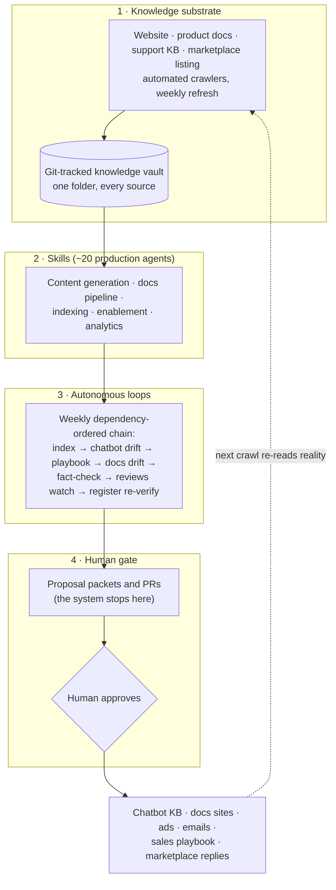

# AI-operated growth engine

The AI operating system that let a team of one run a full go-to-market function: paid acquisition, content, three documentation sites, a customer-facing chatbot, sales enablement, customer intelligence and monthly reporting. Built and run in production in 2026 for GeoDin, Fugro's geotechnical data management software, on top of a go-to-market rebuilt from 2023, while subscriptions went from 1% of its external sales (2023) to ~90% expected for 2026, and perpetual licensing went to zero.

This repository shows the system as built, sanitized. It is a showcase, not a kit. The case studies explain what ran and why it took this shape, and the architecture notes document the patterns. Customer data, pricing and internal addresses stay out.

## How it is built

The working rule: the system detects and drafts, a person approves. No loop posts, merges or publishes on its own. A loop ends in a proposal, an accepted proposal becomes a pull request, and a person merges it, often Nuno himself. Every change sits in a history anyone in the team can read.

## What it produced

Figures as published on LinkedIn; the euro values behind them stay private.

- A 6,300-contact lead funnel across 60+ countries, 2,900 of them sales-qualified, with paid social as the #2 lead source. Campaigns customized across 20+ segments, with an automated chain from LinkedIn ad to CRM sequence to a team notification that tags who follows up.
- Web traffic up ~30× and monthly impressions from 0 to 150k.
- A website chatbot built with two freelancers for about USD 2k, live in under a month, that led to two closed deals in four months.
- Long-form articles placed on geoengineer.org and Autodesk's Digital Builder blog; AI assistants referring leads by mid-2026.
- Documentation rebuilt from a legacy archive into self-service docs across three product suites, through a PR-gated docs-as-code pipeline.

## Read

**Case studies** (`evidence/case-studies/`). Seven chapters on the parts of the engine, and one on how it was run.

*The motion*
- [From perpetual licenses to a product-led subscription business](evidence/case-studies/00-from-perpetual-licenses-to-a-product-led-subscription-business.md). Before: an old website that read as documentation for power users, an offering nobody could parse, no self-checkout. After: one product, three variants, trial first, online checkout, and a subscription base that carries the business.

*The machine*
- [A CRM built from zero, and what stayed manual](evidence/case-studies/01-a-crm-built-from-zero-and-what-stayed-manual.md). The data model, the triggers that make a marketing-qualified lead, the criteria that make a sales-qualified one, the Shopify link, and the freelancer who handled what did not make sense to automate.
- [Paid media that ends in a human follow-up](evidence/case-studies/02-paid-media-that-ends-in-a-human-follow-up.md). Campaigns customized across 20+ segments, each wired from LinkedIn ad to HubSpot sequence to a Teams notification that tags who follows up; and the monthly budget review that decided where the money went next.
- [A chatbot that watches itself](evidence/case-studies/03-a-chatbot-that-watches-itself.md). Built with two freelancers for about USD 2k, live in under a month, two closed deals in four months; its knowledge base is a versioned, PR-reviewed repo, and a weekly drift watch proposes the edits.
- [Docs as code, three sites](evidence/case-studies/04-docs-as-code-three-sites.md). From a legacy archive nobody used to self-service docs for new users and deep reference for power users, built from help files, support portal and demo transcripts through a PR-gated pipeline and kept in sync by a drift watch.

*Steering the business*
- [The numbers machine: monthly reporting in Python and a Shopify app](evidence/case-studies/05-the-numbers-machine-monthly-reporting-in-python-and-a-shopify-app.md). A rules-based reporting engine on git that turned subscription chains, Shopify orders and cohorts into the monthly reporting done with Fugro corporate finance and a five-year projection; the rules themselves, and why a spreadsheet could not hold them.
- [A financial model the leadership team could click](evidence/case-studies/06-a-financial-model-the-leadership-team-could-click.md). The five-year model rebuilt as a Lovable app for the investment-committee presentations to Fugro's CEO and CFO: scenarios, levers, one screen per decision, instead of a spreadsheet passed around by email.

*How it was run*
- [The AI operating system](evidence/case-studies/how-it-was-run-the-ai-operating-system.md): about 20 production skills, a weekly chain of autonomous loops, a human gate on everything customer-facing. The system that let a team of one run all of the above.

**Architecture** (`architecture/`). Short notes on the mechanisms, written from the chapters.
- [The weekly loop chain](architecture/loop-chain.md): one chain in dependency order instead of jobs on a timer.
- [The human gate](architecture/human-gate.md): proposal, pull request, a person merges.
- Patterns: [fan-out and merge](architecture/patterns/fan-out-merge.md) · [parallel research, one writer](architecture/patterns/research-writer.md) · [manifest-driven incremental runs](architecture/patterns/manifest-driven-incremental.md) · [drift watch](architecture/patterns/drift-watch.md).

**Thesis** (`thesis/`). Two short essays: [what stayed human, and why](thesis/what-stayed-human.md) · [the next 18 months of B2B buying](thesis/next-18-months-of-b2b-buying.md).

**Runnable rebuilds.** Three of the patterns exist as fresh, generic tools anyone can run: [platform-profile](https://github.com/nunomnferreirapt/platform-profile), [article-pipeline](https://github.com/nunomnferreirapt/article-pipeline), [source-to-docs](https://github.com/nunomnferreirapt/source-to-docs). Each says what it rebuilds; the originals stayed with the company they were built for.

## What is left out, and why

- Customer names, pricing logic, partner terms, and every absolute figure: sales, revenue base, pipeline, costs, customer and seat totals. Confidentiality toward the former employer holds. The figures that do appear are relative ones (shares, growth rates, ratios and funnel counts), already published on LinkedIn.
- Files that could not be scrubbed cleanly are rewritten as representative examples and say so. Nothing here is reconstructed to look like a leak.
- What broke stays in. One guardrail was added after a real failure: a knowledge base shrunk by a bad crawl. One failure stays in as told: an agent that reported an action it had not taken. The case studies tell both stories.

## Who built this

Nuno Ferreira, who builds growth engines: the systems that produce the revenue. This one ran GeoDin's go-to-market in 2026, on a motion rebuilt from 2023. None of it was a solo act: it sat on the work of the product lead and a small delivery team who modernized the product, the release process and the ways of working in parallel.

Built with AI, mostly Claude Code, with OpenAI and Perplexity Pro along the way. The architecture, the agent design, the evaluation and every call on what reached customers stayed human: Nuno and the team.

More on [LinkedIn](https://www.linkedin.com/in/nunomnferreira).
