# The weekly loop chain

The skills that had to run every week ran in one chain, in dependency order: index, chatbot drift, playbook, docs drift, fact-check, reviews watch, register re-verify. Seven stages in one chain replaced six jobs that ran at fixed times.

## What it does

1. **Index.** Crawlers refresh the knowledge vault from the website, the documentation, the support articles and the marketplace listing. The vault is under git, so every refresh is a diff.
2. **Chatbot drift.** The chatbot's knowledge base is compared with the fresh vault; differences become a drift report.
3. **Playbook.** The sales playbook is checked against the same vault.
4. **Docs drift.** The documentation sites are compared with their sources; gaps become proposed pull requests.
5. **Fact-check.** The two master sales documents, written by people, are checked against the sources; differences become paste-ready edits for a named approver.
6. **Reviews watch.** New marketplace reviews are collected, with draft replies.
7. **Register re-verify.** The list of gaps only a person can close is checked against what was merged that week.

Nothing in the chain publishes. Every stage that touches the outside world ends in a proposal or a pull request; see [the human gate](human-gate.md).

## Why this shape

The first version ran the jobs at fixed times, a few hours apart. When one ran long, the next started on top of it. When a crawl failed quietly, the stages after it worked from last week's sources. In one chain, a failed crawl marks everything after it as failed too. A guard restores the knowledge base when a crawl shrinks it sharply, added after a bad crawl did exactly that. Nuno looked at the results when he had time, saw what had run and what had failed, and acted on it.

## What would change next time

Start with the chain, not the clock.
