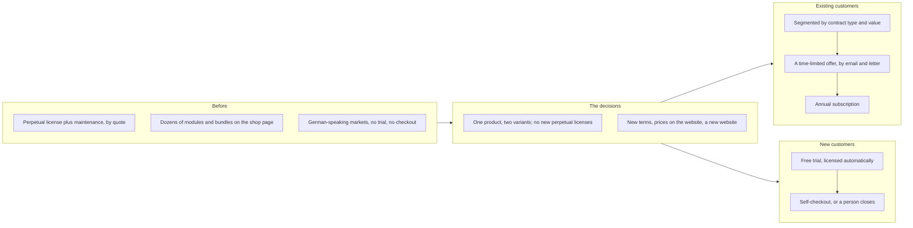
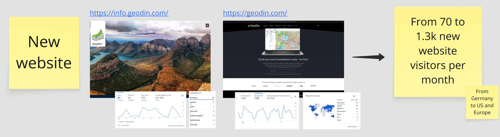
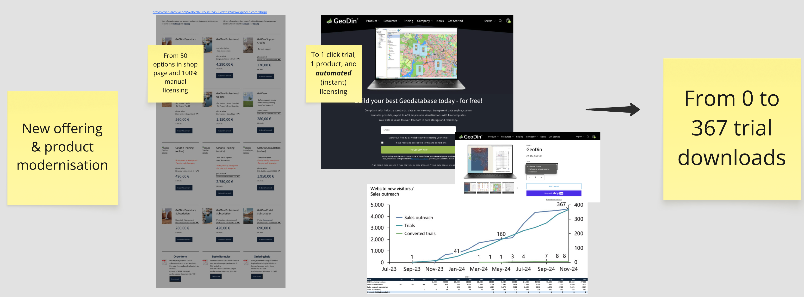
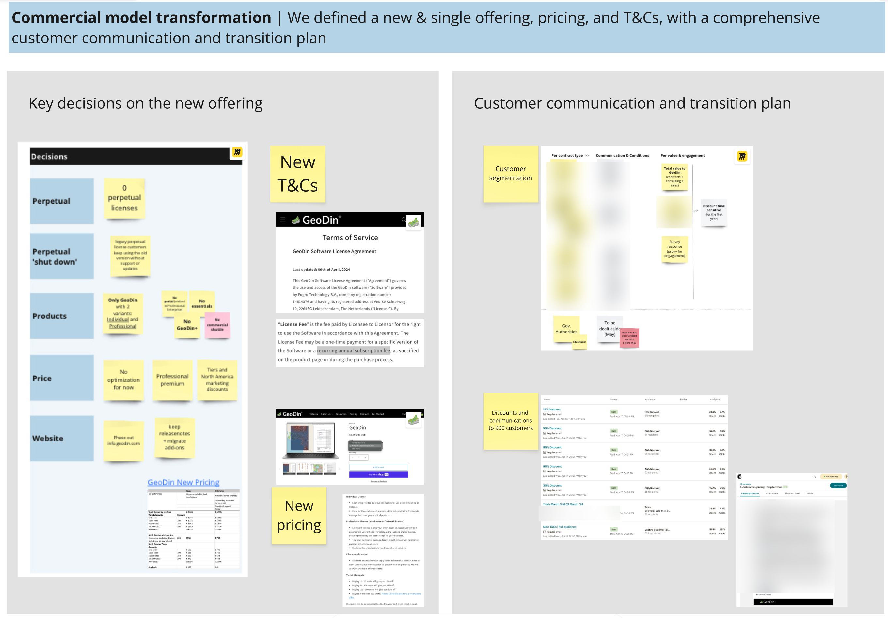

# From perpetual licenses to a product-led subscription business

*Before: an old website that read as documentation for power users, an offering nobody could parse, no self-checkout. After: one product, three variants, trial first, online checkout, and a subscription base that carries the business.*

## Before

GeoDin is Fugro's geotechnical data management software. It has been built in Berlin for nearly three decades and sold the same way throughout: a perpetual license plus a maintenance fee, almost entirely in German-speaking markets, by quote. When I took over the commercial side in 2023 there was no CRM, no subscription product and no way to try or buy anything without talking to someone. The website listed dozens of "products" that were really modules and bundles, and read like documentation for people who already used the software. Subscriptions were 1% of external sales. Perpetual licensing was 80%.

## What we built

Four moves, roughly in this order.

1. **One offer instead of dozens.** The legacy modules were consolidated into one product with per-user pricing. Later it grew into a suite of three: the desktop database, a field app for tablets, and a plug-in for Civil 3D. Prices went on the website. Seat tiers were built so that adding a seat never makes the bill cheaper, which sounds obvious and is not how most volume schedules behave.

2. **A path for the existing base.** Every legacy customer got an offer to move onto an annual subscription priced on value, with a discount schedule that stepped down over the first years. Nobody was forced. 40% of the legacy base migrated, at 3.8 times the average value per customer, so the migrated book alone is 1.5 times the entire 2023 perpetual base. 49 customers who had lapsed came back.

3. **Trial first.** A free trial with automated licensing and trial emails, a first-run welcome flow and English test data, so an engineer anywhere sees something useful in the first ten minutes without asking us. The field app got an ungated one-month trial.

4. **Self-checkout.** A Shopify store with published prices, VAT handled per country and prices per country, for the customers who want to buy that way. The checkout is there for the customers who do not want the conversation; for everyone else, a person closes the deal.

*The website before and after: from a brochure site for people who already used the software to a trial-first landing page, and new visitors from Germany to the US and the rest of Europe.*

*The offering before and after: fifty options and fully manual licensing on the 2023 shop page; one product, a one-click trial and instant licensing after. The curve: sales outreach, trials and converted trials from mid-2023 to late 2024.*

*The transformation board: the decisions on the new offering, terms and pricing on the left; on the right, the communication and transition plan for the existing base, segmented by contract type and value.*

## What stayed human

Pricing, packaging and the migration terms were decisions, not outputs. So was every deal. The trial opens the conversation; a person closes it.

## What it did

Subscriptions went from 1% of external sales in 2023 to ~90% expected for 2026, and perpetual licensing from 80% to 0%. External sales went from flat to a 17% CAGR over 2024 to 2026. Net revenue retention is ~110%, value churn 3.4%, with zero churn among new logos. The free trial became the largest entry point for new customers; about 1 in 5 started on one, in a category that mostly buys by PDF quote. The first customers in the US, Belgium, Canada and Lithuania arrived, and the product was sold to Fugro's competitors for the first time in its history.
