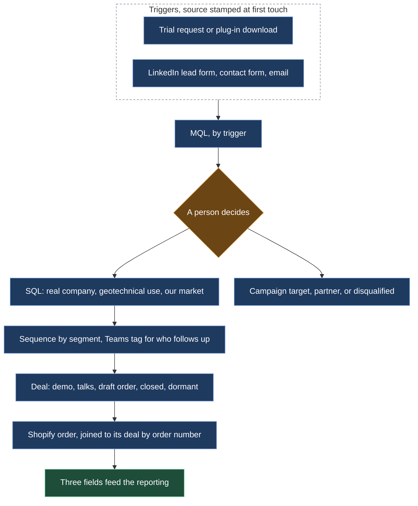

# A CRM built from zero, and what stayed manual

*The data model, the triggers that make a marketing-qualified lead, the criteria that make a sales-qualified one, the Shopify link, and the freelancer who handled what did not make sense to automate.*

## Before

There was no CRM. Customer history lived in inboxes, spreadsheets and people's heads. Orders went through a Shopify store that nobody treated as a source of truth. If you asked where a customer had come from, or how many leads a campaign had produced, there was no answer.

## What we built

**HubSpot, from an empty account.** Contacts, companies and deals, with one sales pipeline whose stages matched how deals actually moved: a technical demo, talks, a draft order, closed, or dormant. Three fields on every deal drive everything downstream, including the financial reporting: the subscription type (new, renewal, expansion), the market (German-speaking or not), and the customer type (new, reactivated, migrated).

**One order, one deal.** Every Shopify order has exactly one HubSpot deal, joined by the order number. That single rule is what later let the reporting pipeline classify sales by customer status and region without anyone re-keying anything.

**Marketing-qualified by trigger.** A contact becomes an MQL on an action, not on a judgment: a trial request, a download of the free plug-in, a LinkedIn lead form, a contact form or an email submit, a known company identified on the website. The source is stamped at that moment, so attribution exists from the first touch.

**Sales-qualified by a person.** An MQL becomes an SQL when someone looks at it and says so: a real company, a geotechnical or civil engineering use, a market we sell in. The alternatives are explicit too: campaign target, partner or reseller, disqualified. In the end, 2,900 contacts made it. This is the step I never automated, because the judgment is the point.

**Routing and follow-up.** A LinkedIn ad feeds a HubSpot sequence and posts a Teams notification that tags the colleague who follows up. Dormant SQLs get a short two-email sequence after a month of silence, written in a consultative tone and signed by a person.

**What stayed manual, on purpose.** Data enrichment, mapping orders to deals when the join failed, and qualifying edge cases went to a part-time freelancer hired through Upwork. Cheaper and more reliable than automating the last edge cases.

## What stayed human

The SQL decision. The sequences, written by people. And the reading of the numbers: the LinkedIn-to-HubSpot attribution join showed that paid social was the top of the funnel, not the last touch before a deal, which changed how the budget was judged.

## What it did

A funnel of 6,300 contacts across 60+ countries, 2,900 of them sales-qualified, with paid social as the #2 lead source. The CRM became the base for the financial reporting, the funnel analysis and, later, the AI loops.
