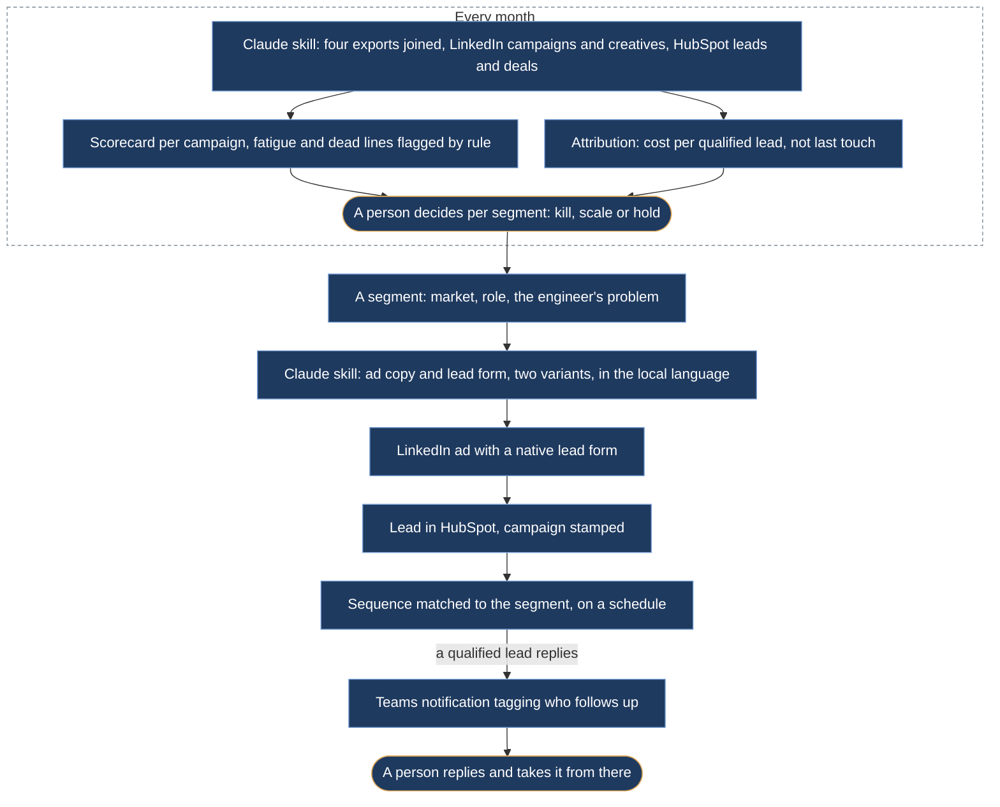
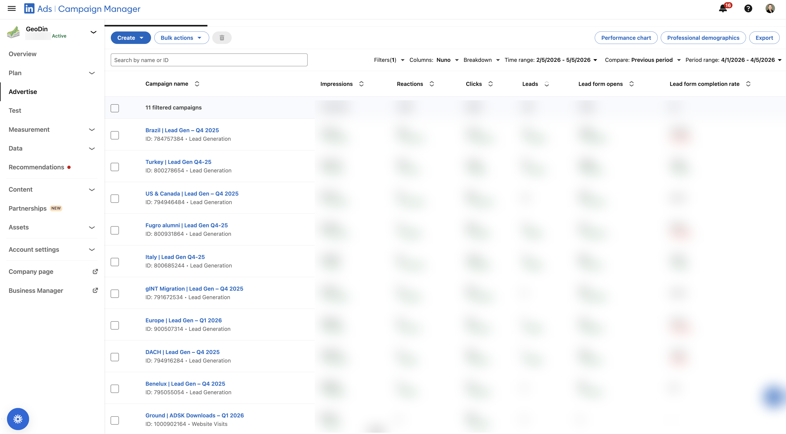
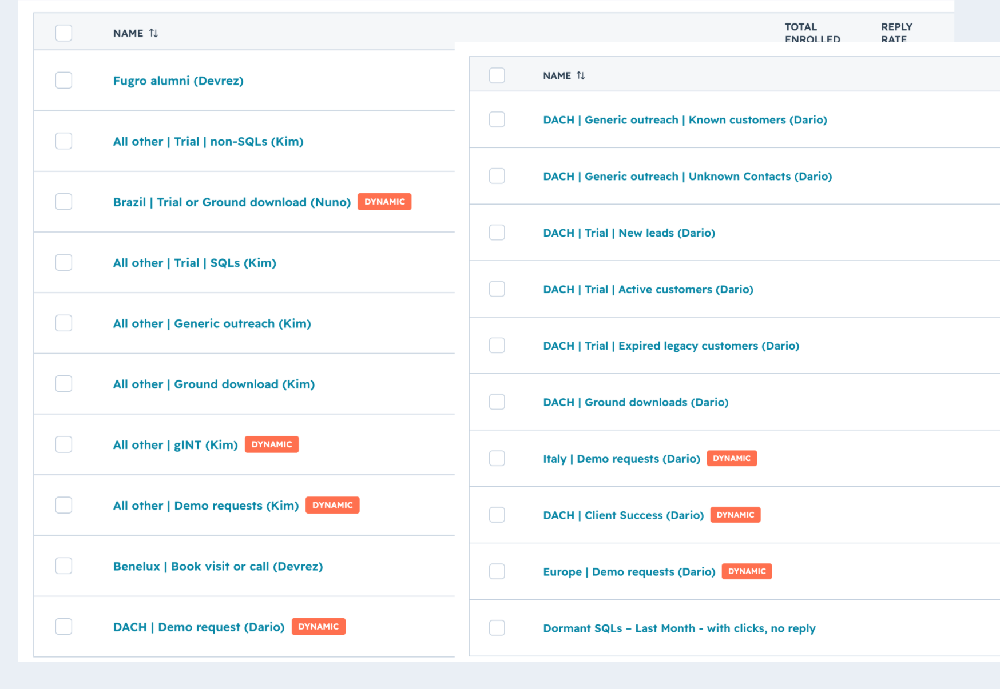
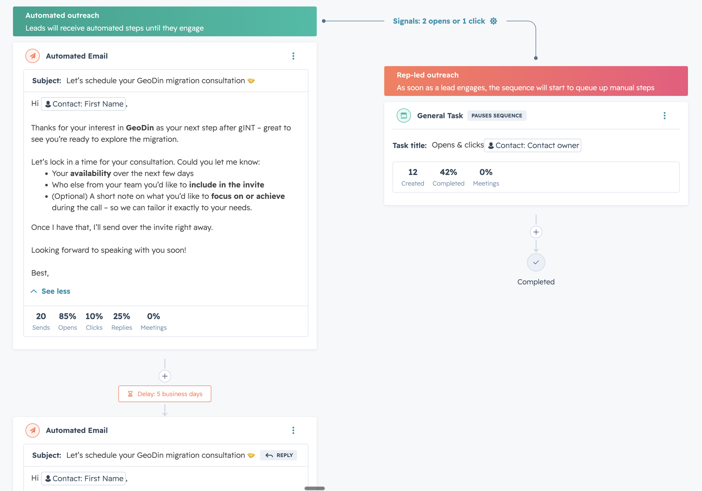
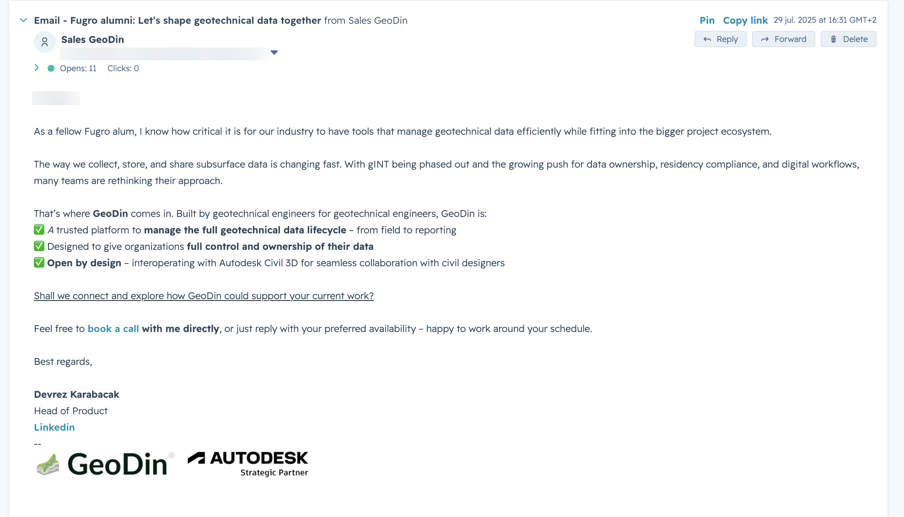

# Paid media that ends in a human follow-up

*Campaigns customized across 20+ segments, each wired from LinkedIn ad to HubSpot sequence to a Teams notification that tags who follows up; and the monthly budget review that decided where the money went next.*

## Before

No paid acquisition. The customer base was German-speaking and had arrived by word of mouth over thirty years. Engineers outside that circle had never heard of the product.

## What we built

**Segments, not one campaign.** More than 20 segments, cut by market, by role and by the problem the engineer has: migrating off an end-of-life incumbent, logging boreholes in the field, getting ground data into Civil 3D. Each segment got its own creative, its own lead magnet and its own landing. The ad copy and the lead form came from a Claude skill that read the product and competitor files and the house tone, and returned two variants, one conservative and one with a stronger hook, in the segment's language; a person picked, edited and launched. Campaigns ran in the local language, including Brazil and Turkey, where the regulatory context does part of the selling.

*LinkedIn Campaign Manager, one line per segment: Brazil, Turkey, US and Canada, Fugro alumni, Italy, the migration off the incumbent, Europe, DACH, Benelux, and a website-visit line for the Civil 3D download. Figures blurred.*

**Native lead forms into the CRM.** Most leads were captured in LinkedIn's native forms rather than on a landing page, and landed in HubSpot with their campaign stamped. From there: a sequence matched to the segment. When a qualified lead replied, a Teams notification tagged the colleague who follows up. The sequences were semi-automated by design. The emails went out on a schedule; the reply was always a person. Enrolment ran in bulk: the freelancer loaded the leads into a sequence and picked the email signature to match the sequence and the segment, so each segment heard from the right colleague.

*The sequence list in HubSpot: one per segment and trigger, the owner in brackets. The ones marked dynamic switch from automated emails to manual steps as soon as the lead engages.*

*Inside one sequence: an automated email, a delay of five business days, and the switch to a rep-led task after two opens or one click. The task pauses the automation and lands with the contact owner.*

*A Fugro alumni email as sent, written as one alum to another and signed by the head of product. The signature was chosen per sequence and segment at enrolment. Recipient blurred.*

**A monthly scorecard.** Spend, leads and the share that qualified, per campaign, in one table. The scorecard was a Claude skill: four monthly exports, LinkedIn campaign and creative performance, HubSpot paid-social leads, qualified leads and deals, joined by a script that the skill kept in repair when an export's columns changed. Creative fatigue was flagged by rule when click-through fell or cost per impression rose past a threshold. Lines that had produced nothing for a quarter were cut and the money moved. The skill carried its own state from month to month: the last period reviewed, the open follow-ups, the budget actions still pending.

**The attribution join.** LinkedIn's numbers and HubSpot's deals joined on the contact, which showed that paid social was feeding the top of the funnel rather than closing deals on its own. That changed how campaigns were judged: by qualified leads, not by last-touch revenue.

## What stayed human

Where the budget went each month, and which campaigns to kill, scale or hold. The scorecard proposed; a person decided, usually me. The copy of every sequence was written and signed by a person.

## What it did

Paid social became the #2 lead source. The campaign markets show up in the funnel as new countries, Brazil and Turkey among them.
