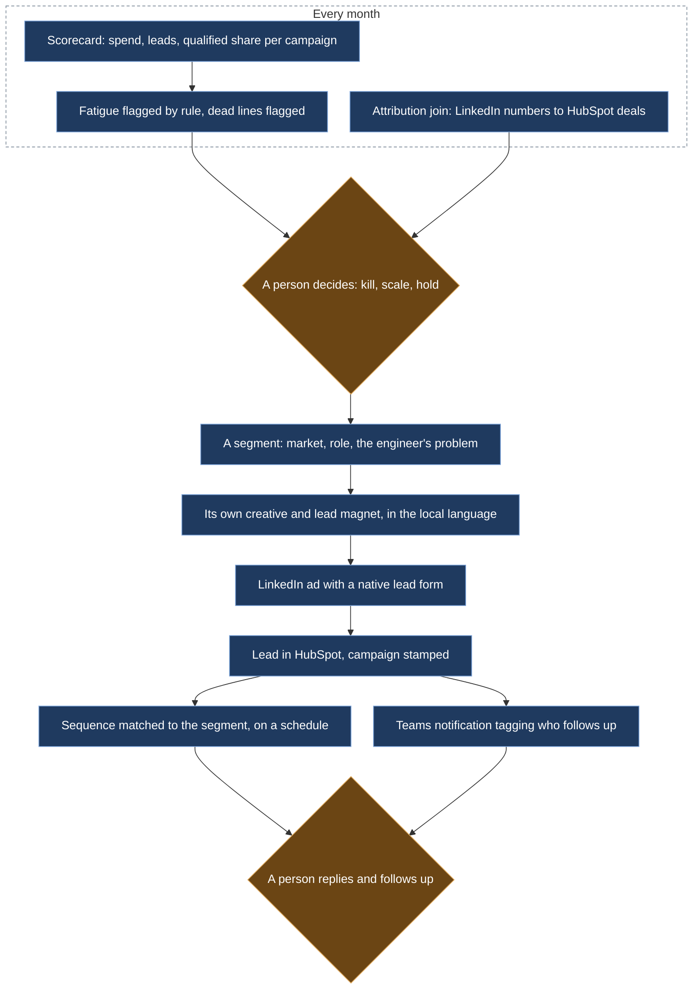

# Paid media that ends in a human follow-up

*Campaigns customized across 20+ segments, each wired from LinkedIn ad to HubSpot sequence to a Teams notification that tags who follows up; and the monthly budget review that decided where the money went next.*

## Before

No paid acquisition. The customer base was German-speaking and had arrived by word of mouth over thirty years. Engineers outside that circle had never heard of the product.

## What we built

**Segments, not one campaign.** More than 20 segments, cut by market, by role and by the problem the engineer has: migrating off an end-of-life incumbent, logging boreholes in the field, getting ground data into Civil 3D. Each segment got its own creative, its own lead magnet and its own landing. Campaigns ran in the local language, including Brazil and Turkey, where the regulatory context does part of the selling.

**Native lead forms into the CRM.** Most leads were captured in LinkedIn's native forms rather than on a landing page, and landed in HubSpot with their campaign stamped. From there: a sequence matched to the segment, and a Teams notification tagging the colleague who follows up. The sequences were semi-automated by design. The emails went out on a schedule; the reply was always a person.

**A monthly scorecard.** Spend, leads and the share that qualified, per campaign, in one table. Creative fatigue was flagged by rule when click-through fell or cost per impression rose past a threshold. Lines that had produced nothing for a quarter were cut and the money moved. The scorecard was built once and regenerated every month.

**The attribution join.** LinkedIn's numbers and HubSpot's deals joined on the contact, which showed that paid social was feeding the top of the funnel rather than closing deals on its own. That changed how campaigns were judged: by qualified leads, not by last-touch revenue.

## What stayed human

Where the budget went each month, and which campaigns to kill, scale or hold. The scorecard proposed; a person decided, usually me. The copy of every sequence was written and signed by a person.

## What it did

Paid social became the #2 lead source in a funnel of 6,300 contacts across 60+ countries, 2,900 of them sales-qualified. The campaign markets show up in that funnel as new countries, Brazil and Turkey among them.
