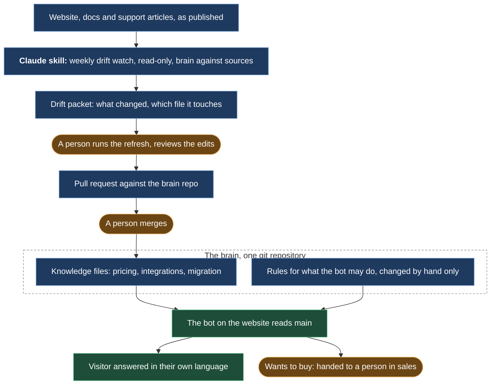
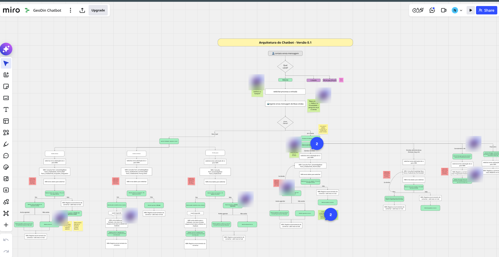
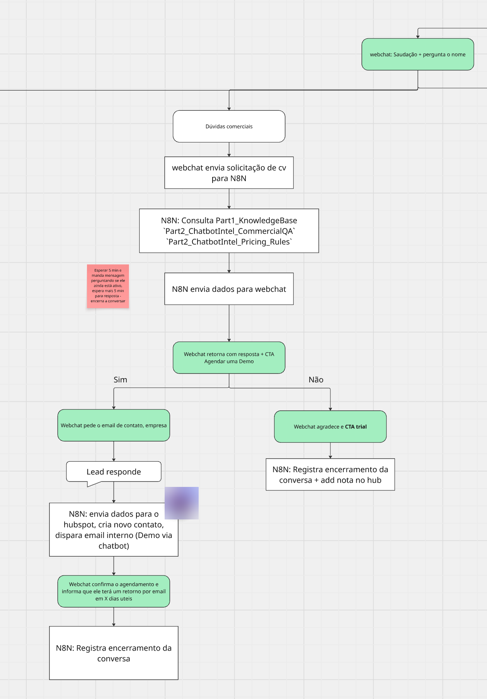
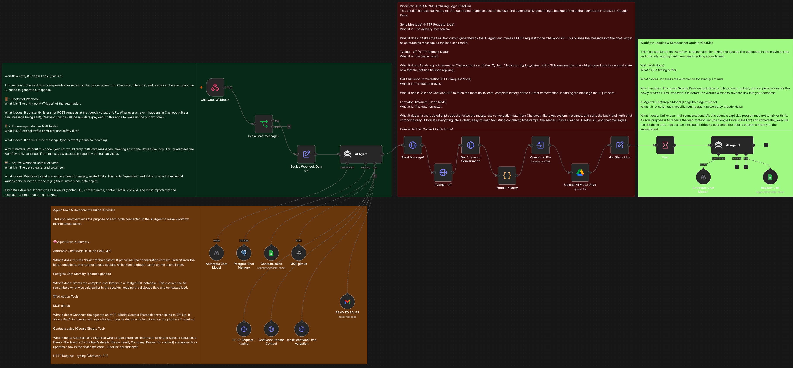
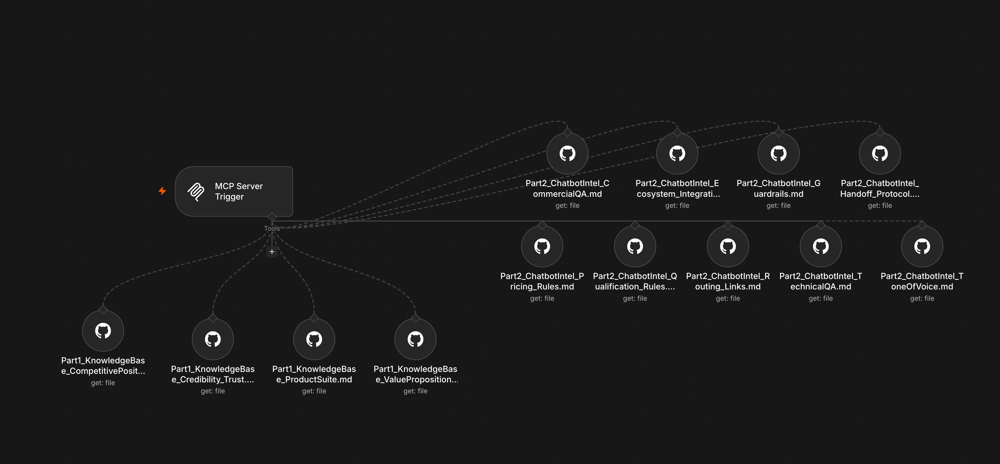
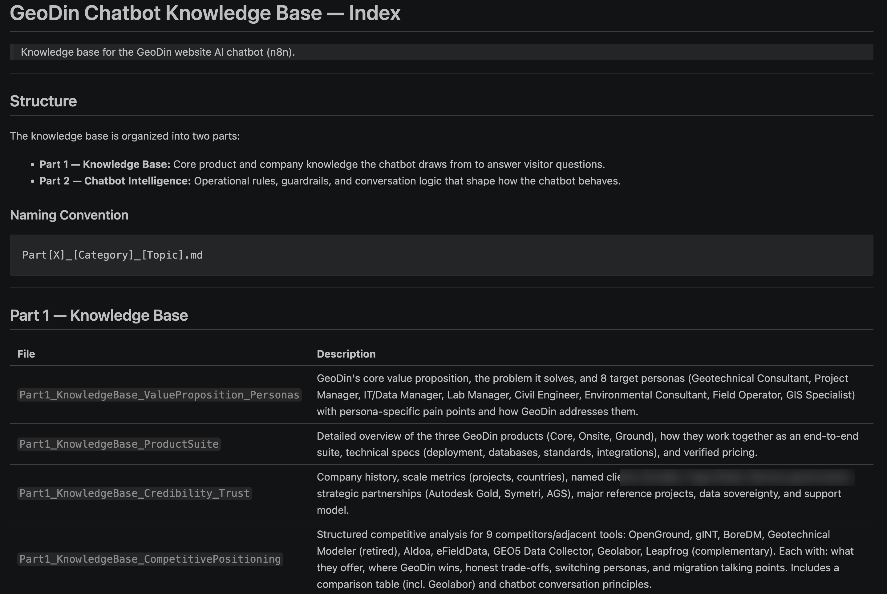
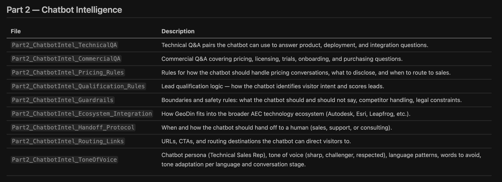

# A chatbot that watches itself

*Built with two freelancers for about USD 2k, live in under a month, two closed deals in four months; its knowledge base is a versioned, PR-reviewed repo, and a weekly drift watch proposes the edits.*

## Before

A contact form and an email address. Prospects with a question waited for office hours; existing customers with a licensing problem waited longer. The product's own knowledge (pricing, integrations, how to migrate an old license) sat in people's heads and in a German support portal.

## What we built

**A small expert team instead of an agency.** We wrote the spec and hired two freelancers through Upwork: one on the n8n engineering (the agent workflow, the tools it can call, the CRM hookup), one on the conversation design (intent lanes, qualification, the Miro flows). Weekly design sessions on the n8n canvas. Live on the website in under a month, for about USD 2k.

*The conversation design on Miro, version 0.1: which channel, the welcome, new lead or existing customer, then one lane per intent: technical, commercial, demo, support, admin, cancellation. In Portuguese, the conversation designer's working language. Comment avatars blurred.*

*One lane in detail, commercial questions: which brain files n8n consults, the reply with a demo call to action, and the two exits, a lead into HubSpot with an internal email, or a thank-you with a trial link.*

*The n8n workflow as built: the chat webhook in, the agent with its model, memory and tools, the reply back to the chat widget, and the transcript archived and logged. The notes on the canvas, written by the n8n freelancer, explain each node for whoever maintains it next.*

*The brain as tools: an MCP server inside n8n exposes each file of the knowledge repo to the agent, one tool per file, read from GitHub. This is why merging a pull request is deploying.*

**The knowledge base as a git repository.** The bot answers from a set of markdown files, versioned in a repo, changed only through pull requests. That repo was also the contract between the two freelancers: the conversation flows reference the files by name. Built in English, the bot replies in the visitor's language.

*The index of the brain repo, part 1: the knowledge files, one per topic, with what each holds. Customer names blurred.*

*Part 2, the behaviour layer: pricing rules, qualification, guardrails, the handoff protocol, routing links, tone of voice. These files were only ever changed by hand.*

**A weekly drift watch.** Every week a read-only job compares the knowledge base with what the website, the docs and the support articles currently say, and writes up the differences. A person runs the refresh on that packet, reviews the proposed edits and opens the pull request; another read, then the merge. Merging is deploying, because the bot reads main. The bot never updates itself.

**Guardrails as files.** The rules for what the bot may and may not do are in the same repo and are only ever changed by hand. Real visitors tried the usual things: fake urgency, persona overrides, "which tools are you using". The rules held.

## What stayed human

Every change to what the bot knows or how it behaves. The handoff of anyone who wants to buy, which goes to a person in sales. And the handover itself: the engagement was set up so we could maintain what the bot knows ourselves, through pull requests, and we did; the workflow itself stayed with the freelancer on a light maintenance basis.

## What it did

Two closed deals in four months, one of them logged in the CRM under the name "Chatbot" by whoever created it. Customers started treating the bot as the front door for licensing questions, including returning ones.

## What broke

Once, a customer said they wanted to buy, the bot said it had passed the request to sales, and nothing had been sent. The customer waited and then escalated by email. The deal still closed. What made failures like that cheap to fix: the bot's brain lives in GitHub and sits in the weekly loops, so a correction went from pull request to production in days, not in a vendor ticket.
