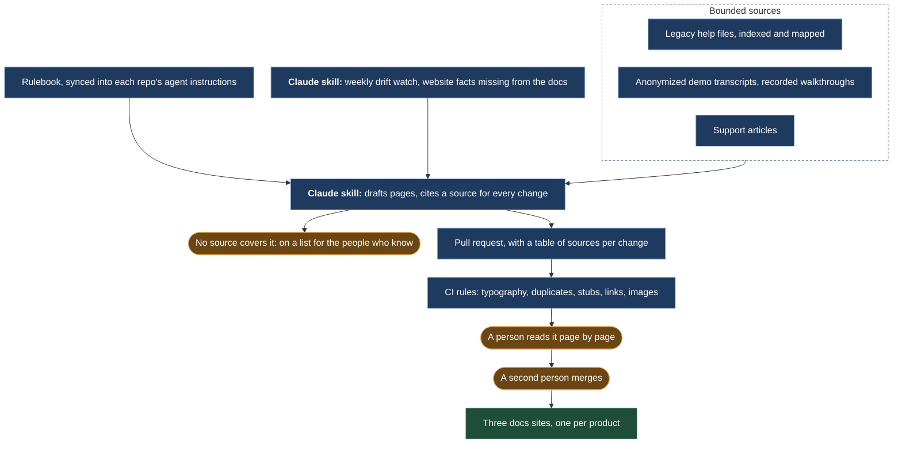
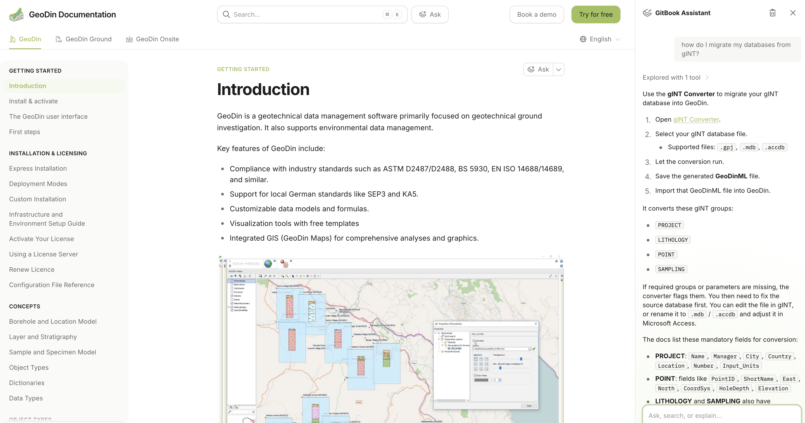
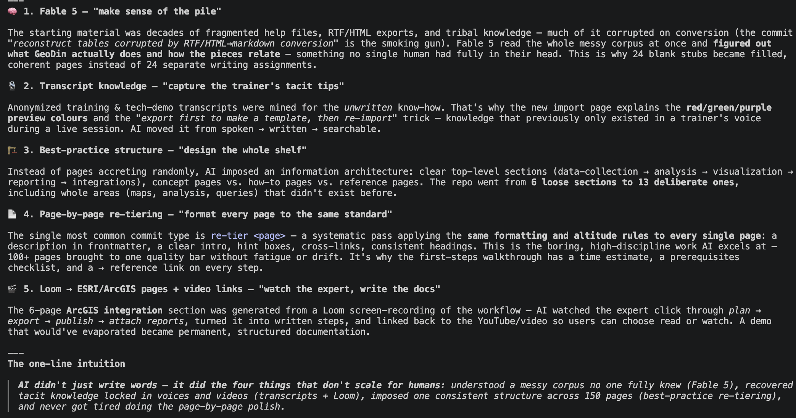
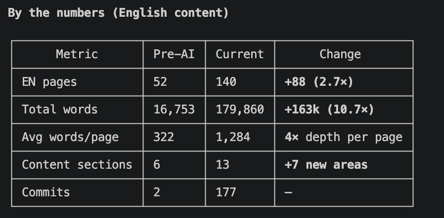
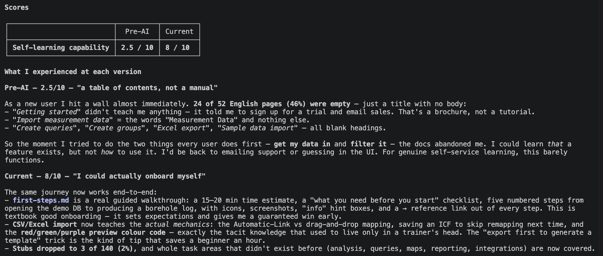

# Docs as code, three sites

*From a legacy archive nobody used to self-service docs for new users and deep reference for power users, built from help files, support portal and demo transcripts through a PR-gated pipeline and kept in sync by a drift watch.*

## Before

The legacy help, locked in a Windows help database. A public docs site full of empty stubs. A German support portal that covered what the docs did not. New customers stalled in the trial because the first ten minutes were not documented, and power users emailed support for lookups the product could have answered.

## What we built

**Docs as a software project.** Three public repositories, one per product, rendered as websites on GitBook, whose built-in assistant answers visitors from the pages themselves. A private companion repository with the audit, the rulebook and the migration plan. Every legacy help topic was indexed and mapped to a destination page or marked for retirement; the result was a list of work packages, not a vague ambition.

*The docs site as published: three products in one portal, and the off-the-shelf GitBook assistant answering a migration question from the documentation itself. This is where the website chatbot sends troubleshooting questions.*

**Drafts from bounded sources.** An AI pipeline turned the sources we had (the legacy help files, anonymized demo transcripts, support articles and recorded walkthroughs) into draft pages and pull requests. Every change cites its source, and every PR carries a table of sources per change. The pipeline may not invent; if no source covers a question, it goes on a list for the people who know the product.

*From the June review of the work: the five things the pipeline did that do not scale for people. It read the whole messy corpus at once, mined the transcripts for the trainer's unwritten tips, imposed one structure, re-tiered every page to the same standard, and turned one screen recording into a six-page integration section.*

**Rules in three layers.** Mechanical rules in CI: typography, duplicated content, empty stubs, broken links, changed images. Judgment rules in a rulebook synced into each repo's agent instructions. Procedure in two contribution skills anyone on the team can run.

**A weekly drift watch.** Product facts the website states but the docs do not, flagged weekly and turned into proposed changes.

## What stayed human

Nothing reaches a public site without a person reading it page by page. I checked each pull request in the diff view; the product lead merged. The list of gaps no written source could fill went to the people with the product knowledge, by name.

## What it did

From a legacy archive nobody used to self-service documentation for new users and deep reference for power users, across the three product suites.

**As a new user saw it.** An evaluator reading the desktop docs as a first-time user scored the old site "a table of contents, not a manual": nearly half the English pages were a heading with no body, and the two things every user does first, get data in and filter it, were not explained anywhere. The same read of the new site: "I could actually onboard myself". A guided first-steps walkthrough with a time estimate and a checklist, the import mechanics that used to live only in a trainer's voice, stubs down to a handful, and whole task areas that did not exist before: analysis, queries, maps, reporting, integrations. In numbers, relative: pages up almost three times, words up ten times, depth per page up four times, six loose sections turned into thirteen deliberate ones.

*The June tally for the English content, before the pipeline and after.*

*The evaluator's score for self-learning, and its notes on each version.*

**Then a blind re-test.** In July an independent evaluator was given the desktop docs under a neutral name, not told which version, and had to complete the same new-customer tasks and power-user lookups from the docs alone. The result moved from "you need a support ticket for daily work" to "self-serve for most tasks".

**Then the handover.** In October 2026 the process was handed over as two skills, a rulebook and a reviewer checklist. Client success contributes; one reviewer merges.

## What I would do differently

Introduce the CI layer on day one. The first months relied on reviewers catching typography and duplication by eye, and the same problems came back until they became rules.
