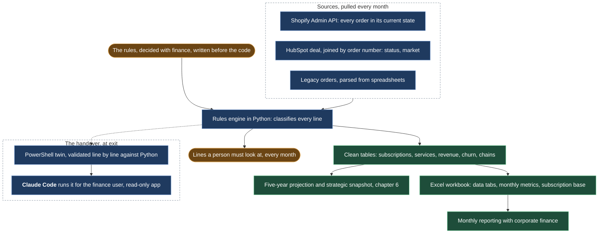

# The numbers machine: monthly reporting in Python and a Shopify app

*A rules-based reporting engine on git that turned subscription chains, Shopify orders and cohorts into the monthly reporting done with Fugro corporate finance and a five-year projection; the rules themselves, and why a spreadsheet could not hold them.*

## Before

Monthly top-line reporting to corporate finance ran on a manually maintained Excel fed by Shopify's CSV export. The export has two flaws that nobody had noticed. An edited order keeps its removed lines in the CSV, so a single edit could more than double that order's total. And a canceled, unpaid order keeps its full value unless someone filters it out. Every month the numbers were a little wrong in ways that could not be traced.

## What we built

**A pipeline, in Python, in a repository.** Three layers. Pull: the Shopify Admin API, which reports every order in its current state after edits and refunds, into raw order and transaction files. Clean: a rules engine that classifies every line and produces the clean tables: subscriptions, services, trials, monthly revenue, credit notes, cancellations, defaults, churn events, subscription chains, and a file of lines a person must look at. Report: an Excel workbook with the data tabs, the monthly metrics, the renewal chains and the subscription base.

**The rules, written down before the code.** Gross sales net of VAT at order date. Revenue on an accrual basis: subscriptions spread over the service period, which can start in a later month than the order, services recognized at each payment. Adjustments treated prospectively: a refund or cancellation is booked as a reversal in the month it happens, and past reports are never restated. Orders unpaid past a threshold written off as a loss. Five VAT scenarios across countries, all handled by trusting the API's net amounts rather than rebuilding tax logic. Each rule has its case in an edge-case log, and the pipeline was validated against every one of them.

**HubSpot as the second source.** Each order joins to exactly one CRM deal by order number, which is where customer status and market come from. Pre-Shopify legacy orders were parsed from spreadsheets so the renewal chains reach back to year zero.

**The five-year projection on top.** The clean base feeds a forecast model with scenarios and dials, the one behind the next chapter, and a strategic snapshot regenerated from the same pipeline for the investment committee.

**The handover.** At exit, finance needed to keep cross-checking their report every month, on a Windows machine with no Python, no git and no admin rights. The pipeline was scoped down to what Shopify alone can prove, ported to PowerShell, validated line by line against the Python version, and set up so that Claude Code runs it for the finance user from a read-only Shopify app owned by the organization. One handover session on the last day. It ran.

## What stayed human

The rules. Every one of them was a decision made with finance, and when I proposed a "better" cancellation rule halfway through, the functional owner rejected it in one line: the reference table is what finance recognizes. The rule went in as a memo line outside the totals. The lines flagged for manual review are a person's job, every month.

## What it did

Monthly reporting with Fugro's corporate finance team that reconciles to the euro. The same base produced the subscription growth figures on the front page, the renewal chains behind the retention numbers, and the snapshot the five-year plan is anchored to: EBITDA from -67% in 2023 to break-even in the 2027 plan.

## What I would do differently

Write the monthly operating procedure while I was still the only operator. It was a known open item for months and became the hardest part of a one-session handover.
