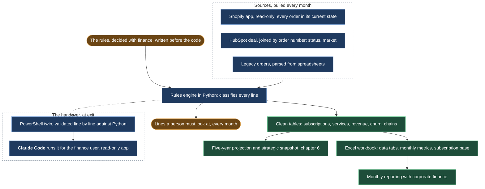

# The numbers machine: monthly reporting in Python and a Shopify app

*A rules-based reporting engine on git that turned subscription chains, Shopify orders and cohorts into the monthly reporting done with Fugro corporate finance and a five-year projection; the rules themselves, and why a spreadsheet could not hold them.*

## Before

Monthly top-line reporting to corporate finance ran on a manually maintained Excel fed by Shopify's CSV export. The export has two flaws that nobody had noticed. An edited order keeps its removed lines in the CSV, so a single edit could more than double that order's total. And a canceled, unpaid order keeps its full value unless someone filters it out. Every month the numbers were a little wrong in ways that could not be traced.

## What we built



**A Shopify app for the data.** Built with Claude Code: a read-only app, owned by the organization, that exports every order in its current state, after edits and refunds, in the shape the pipeline needs. The CSV export was never used again.

**A pipeline, in Python, in a repository.** Three layers:

- Pull: orders and transactions from the Shopify app, into raw files.
- Clean: a rules engine classifies every line into the clean tables: subscriptions, services, trials, monthly revenue, credit notes, cancellations, defaults, churn events, subscription chains. Plus a file of lines a person must look at.
- Report: an Excel workbook with the data tabs, the monthly metrics, the renewal chains and the subscription base.

```
Shopify Admin API
        │
        ▼
Layer 1: scripts/shopify_pull.py     → outputs/<pull>/orders.csv
                                        outputs/<pull>/transactions.csv
        │
        ▼
Layer 2: scripts/clean_transactions.py  → outputs/<pull>/clean_subscriptions.csv
                                          outputs/<pull>/clean_services.csv
                                          outputs/<pull>/trials.csv
                                          outputs/<pull>/revenue_monthly.csv
                                          outputs/<pull>/credit_notes.csv
                                          outputs/<pull>/churn_events.csv
                                          outputs/<pull>/manual_review.csv
                                          outputs/<pull>/summary.json
        │
        ▼
Layer 2b: scripts/parse_legacy_orders.py → outputs/<pull>/legacy_*.csv
                                           (pre-Shopify data from Excel; anchors
                                            renewal-chain Year 0)
        │
        ▼
Layer 3: scripts/generate_workbook.py  → outputs/<pull>/financial-report.xlsx
                                          (data tabs, monthly metrics, renewal
                                           chains, Subscription Base tab, charts)
```

<details>
<summary>The repository layout, from its README</summary>

```
geodin-financial-reporting/
├── README.md                  ← this file
├── CLAUDE.md                  AI/session orientation (read-first map, common commands)
├── docs/
│   ├── project-progress.md                 running scope + progress log ("Revamp" log) — start here
│   ├── data-model.md                       canonical clean-transaction schema
│   ├── rules.md                            transformation + recognition methodology
│   ├── cleaning-rules-checklist.md         implementation contract (rules.md → code)
│   └── methodology-summary-for-fugro.md    Fugro-shareable business doc
├── scripts/
│   ├── shopify_oauth_setup.py              one-time OAuth setup (already used)
│   ├── shopify_pull.py                     Layer 1 — monthly / targeted / incremental extraction
│   ├── merge_targeted_into_pull.py         upsert an incremental pull into the main pull
│   ├── clean_transactions.py               Layer 2 — rules engine
│   ├── parse_legacy_orders.py              Layer 2b — pre-Shopify legacy orders (needs venv)
│   ├── build_renewal_chain.py              renewal-chain construction helpers
│   ├── generate_workbook.py                Layer 3 — Excel workbook (needs venv/openpyxl)
│   ├── generate_snapshot.py                strategic snapshot → insights/deliverables/
│   ├── reconcile_renewals.py               monthly renewals reconciliation
│   ├── enhance_renewals_workbook.py        formatting/enrichment for renewals workbook
│   └── refresh.sh                          re-clean + rebuild workbook for latest pull
├── lookups/
│   ├── README.md                           explains user-maintained inputs
│   ├── dach_countries.csv                  DE/AT/CH (small, committed)
│   └── (sku_map.csv, HubSpot CRM exports, discounts, legacy sales DB,
│      off-Shopify refunds, upcoming-renewals xlsx — gitignored, user-maintained)
├── insights/                               strategy & board layer — gitignored except README + CHANGELOG
│   ├── README.md                           layout + source-of-truth convention (bets.json is the bible)
│   ├── CHANGELOG.md                        data-free log of deliverable refreshes
│   ├── deliverables/                       snapshot, forecast inputs, board prep, pricing… (local only)
│   ├── model/                              board forecast engine: bets.json + reconcile.js + trace_bet.js
│   ├── lovable/                            prompts/assets to regenerate the Lovable board page
│   └── process/                            how-we-build notes
├── renewals/                               monthly renewals workspace — fully gitignored (real data)
├── workbook/                               only an empty template may be committed
├── outputs/                                gitignored — real data, one folder per pull
├── .claude/
│   ├── agents/geodin-board-forecast.md     project subagent: board-forecast domain expert
│   ├── settings.json                       shared Claude Code settings (committed)
│   ├── settings.local.json                 personal overrides (gitignored)
│   └── worktrees/                          scratch area for Claude Code git worktrees (empty when idle)
├── .githooks/pre-commit                    reminder hook: log bets.json changes in insights/CHANGELOG.md
└── .gitignore
```

</details>

**The rules, written down before the code.**

- Gross sales net of VAT, at order date.
- Revenue on an accrual basis: subscriptions spread over the service period, which can start later than the order; services recognized at each payment.
- Adjustments prospective: a refund or cancellation is a reversal in the month it happens. Past reports are never restated.
- Unpaid past a threshold: written off as a loss.
- VAT: five scenarios across countries, all handled by trusting the API's net amounts rather than rebuilding tax logic.
- Every rule has its case in an edge-case log, and the pipeline was validated against each one.

**HubSpot as the categorization source.** Each order joins to exactly one CRM deal by order number; customer status and market come from there. Shopify is the money, HubSpot the categories, as set up in [chapter 1](01-a-crm-built-from-zero-and-what-stayed-manual.md). Pre-Shopify legacy orders were parsed from spreadsheets so the renewal chains reach back to year zero.

**The five-year projection on top.** The clean base feeds the forecast model with scenarios and dials, the one in [chapter 6](06-a-financial-model-the-leadership-team-could-click.md), and a strategic snapshot regenerated from the same pipeline for the investment committee.


*The strategic snapshot, regenerated from the pipeline: the single source of truth for actuals, one section per question the board asks.*


*The quarterly board slide, every number traced to the snapshot. The technology committee report took half an hour to update.*

**The handover.** At exit, finance needed to keep cross-checking their report every month, on a Windows machine with no Python, no git and no admin rights. So: the pipeline scoped down to what Shopify alone can prove, ported to PowerShell, validated line by line against the Python version, and set up so that Claude Code runs it for the finance user from the read-only Shopify app. One handover session on the last day. It ran.

## What stayed human

The rules. Every one of them was a decision made with finance, and when I proposed a "better" cancellation rule halfway through, the functional owner rejected it in one line: the reference table is what finance recognizes. The rule went in as a memo line outside the totals. The lines flagged for manual review are a person's job, every month.

## What it did

Monthly reporting with Fugro's corporate finance team that reconciles to the euro. The quarterly report to the technology committee, updated from the snapshot in half an hour. The same base produced the subscription growth figures on the front page, the renewal chains behind the retention numbers, and the snapshot the five-year plan is anchored to: EBITDA from -67% in 2023 to break-even in the 2027 plan.

## What I would do differently

Write the monthly operating procedure while I was still the only operator. It was a known open item for months and became the hardest part of a one-session handover.
