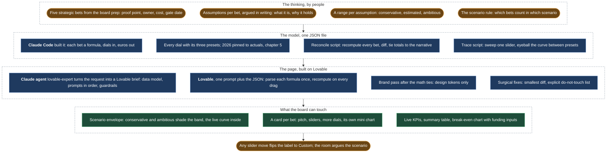

# A financial model the leadership team could click

*The five-year model rebuilt as a Lovable app for the investment committee, Fugro's CEO and CFO: scenarios, levers, one screen per decision, instead of a spreadsheet passed around by email.*

## Before

The five-year plan was a spreadsheet. Every investment-committee meeting re-derived the same questions from it: what happens if churn is two points higher, what if the new market lands a year late, when does this stop needing the group's money. The answers took long enough to produce that they were stale by the meeting.

## What we built

**First the thinking, on paper, by people.**

- Five strategic bets from the board prep, each with a proof point, an owner, a cost and a gate date.
- Per bet, the assumptions argued in writing: what it is, why it should hold, what would prove it.
- Per assumption, a range, not a number: conservative, estimated, ambitious.
- A scenario rule: which bets count in which scenario. A scenario is a composition, not a mood.

**Then the model, as a file nobody can quietly change.**

- One JSON file, built with Claude Code through thirteen one-shot scripts, then archived. The file is the only truth.
- Each bet a small formula: dials and year in, euros out. Next to it, the presets, a one-line pitch and the what-and-why story.
- 2026 is pinned to the actuals from the pipeline in [chapter 5](05-the-numbers-machine-monthly-reporting-in-python-and-a-shopify-app.md) and never moves. The sliders only move 2027 to 2030.
- A reconcile script as the gate: recompute every bet, diff against what is stored, tie the headline to the written narrative. An untouched model must show zero drift.
- A trace script sweeps one slider, so the curve between presets can be seen, not just the three anchor points.
- The editing loop: change, run the gate, read the drift, persist, update the narrative until the tie-check is green, log it.

**Then the page, built in an afternoon.**

- The method came from a Claude Code agent, `lovable-expert`, that turns a request into a hand-off-ready Lovable brief: the data model, the prompts in order, the tasks that belong in Claude Code instead, and the guardrails. Its doctrine shaped the build: spec before prompting, plan in chat mode and build in edit mode, name what to change and what to leave alone, pin a working state before the next change, hand off at the complexity wall.
- Built in Lovable from one prompt and the JSON file, in about two hours. The rule in the prompt: parse each formula once, recompute on every drag, hard-code nothing.
- A brand pass after the math tied, design tokens only.
- Fixes as surgical prompts: one section, the smallest change, an explicit do-not-touch list. Kept in the repository next to the model, so the page can be regenerated.

**What the board can touch.**

- A headline total with a scenario selector. A stacked chart where conservative and ambitious shade an envelope, the board's own live curve inside it.
- A card per bet: pitch, sliders, a "More dials" expander, a toggle that pulls the bet in or out of the headline, a mini chart on the same state.
- Live KPIs that recompute on every drag: customers, revenue per customer, growth rate. A summary table.
- A second chart for the one question a CFO asks in a cost year: when does this stop needing internal funding. The funding line and the cost allocation are inputs.
- Any slider move flips the label to "Custom". A preset name never sits over numbers it no longer describes.

https://github.com/user-attachments/assets/c4ed2ea6-3d1b-4c86-9fc2-b1e16eeae5ce

*A walk through the page, 1 min 42 s, numbers blurred. Watch the scenario selector move the headline curve inside its envelope, a bet card with its sliders and the toggle that pulls it out of the headline, the KPIs recomputing on every drag, and the break-even chart with its editable funding row.*

**And words without numbers.** The narrative notes on the page carry no figures by design. Any number copied into prose would drift from the chart. Every number shown is rendered live from the model.

## What stayed human

The bets themselves, the dials and their presets. The model computes; it does not decide what to believe. In the meeting, the scenario the room landed on was argued, not calculated.

## What it did

The five-year projection presented to the investment committee, Fugro's CEO and CFO, ran on this page. Each bet carried a proof point, an owner, a cost and a gate date, so the committee could decide on evidence. The plan it showed has EBITDA at break-even in 2027.
