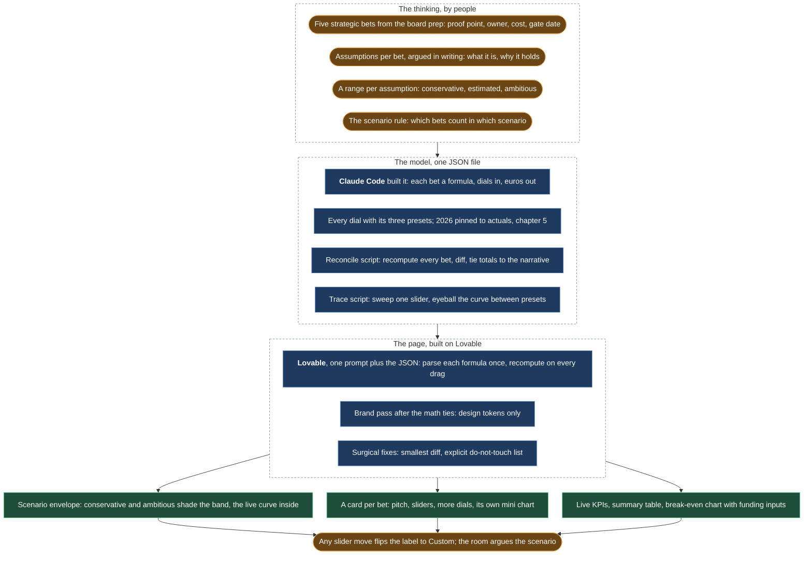

# A financial model the leadership team could click

*The five-year model rebuilt as a Lovable app for the investment-committee presentations to Fugro's CEO and CFO: scenarios, levers, one screen per decision, instead of a spreadsheet passed around by email.*

## Before

The five-year plan was a spreadsheet. Every investment-committee meeting re-derived the same questions from it: what happens if churn is two points higher, what if the new market lands a year late, when does this stop needing the group's money. The answers took long enough to produce that they were stale by the meeting.

## What we built

**The thinking first, on paper.**

- Five strategic bets, taken from the board prep document, each with a proof point, an owner, a cost and a gate date.
- For each bet, the assumptions argued in writing: what the bet is, why it should hold, what would prove it.
- For each assumption, a range rather than a number: a conservative, an estimated and an ambitious value.
- A scenario rule that says which bets count in which scenario, so a scenario is a composition, not a mood.

**The model as a file, not a sheet.**

- One JSON file, built with Claude Code through thirteen one-shot scripts that were then archived: the file is the only surviving truth.
- Each bet is a small formula, dials and year in, euros out, with its dials, their three presets, a one-line pitch and the what-and-why story next to it.
- 2026 is pinned to the actuals from the pipeline in [chapter 5](05-the-numbers-machine-monthly-reporting-in-python-and-a-shopify-app.md) and never moves. The sliders only move 2027 to 2030.
- A reconcile script is the integrity gate: it recomputes every bet from its formula, diffs the result against what is stored, and ties the headline to the written narrative. On an untouched model it must report zero drift.
- A trace script sweeps one slider at a time, so the curve between presets can be looked at, not just the three anchor points.
- The editing loop: change a formula or a preset, run the gate, read the drift, persist, inspect the bet, update the narrative until the tie-check is green, log it.

**A page the board can touch.**

- Built in Lovable from one prompt and the JSON file, designed to ship in about two hours. The prompt fixes the data contract, the compute logic and the layout; the key rule is that the page parses each formula once and recomputes on every drag, so no number is ever hard-coded.
- A brand pass applied after the math tied, touching design tokens only, so it could not break the wiring.
- Lovable builds fast and breaks easily. Each correction was the smallest possible instruction, scoped to one section, with an explicit list of what not to touch. The prompts were kept in the repository next to the model, so the page can be regenerated. The method came from a Claude Code agent that turns a request into a Lovable brief: spec before prompting, name what changes and what stays, pin a working state before the next change.

**What the board sees.**

- A headline total with a scenario selector, and a stacked chart where the conservative and ambitious curves shade an envelope with the board's own live curve inside it.
- A card per bet: its pitch, the primary sliders, a "More dials" expander, a toggle that pulls the bet in or out of the headline, and a mini chart synced to the same state.
- Live KPIs that recompute on every drag: customers, revenue per customer, growth rate. A summary table.
- A second chart for the only question a CFO asks in a cost year: when does this stop needing internal funding, with the funding line and the cost allocation as inputs.
- Any slider move flips the scenario label to "Custom", so a preset name can never sit over numbers it no longer describes.

**Words without numbers.** The narrative notes on the page carry no figures by design. Any number copied into prose would drift from the chart. Every number shown is rendered live from the model.

## What stayed human

The bets themselves, the dials and their presets. The model computes; it does not decide what to believe. In the meeting, the scenario the room landed on was argued, not calculated.

## What it did

The investment-committee presentations to Fugro's CEO and CFO, and the GeoDin board meetings, ran on this page. Each bet carried a proof point, an owner, a cost and a gate date, so the board could decide on evidence. The plan it showed has EBITDA at break-even in 2027.

## What I would do differently

Set the one open price in the model earlier. A placeholder understated it for months and anchored internal conversations low.
