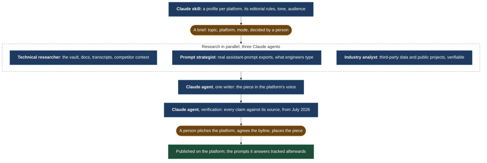
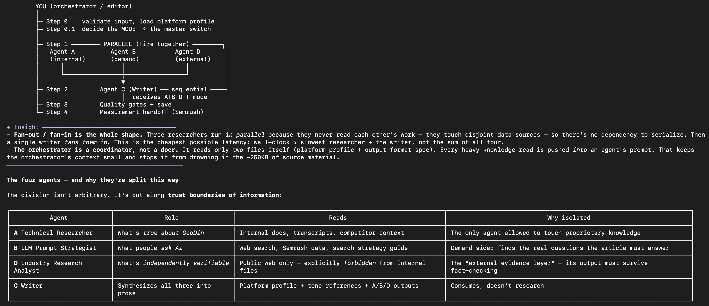
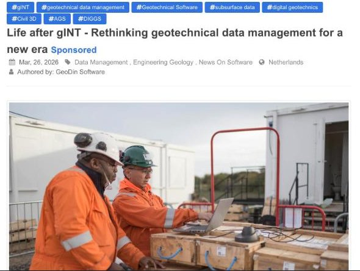
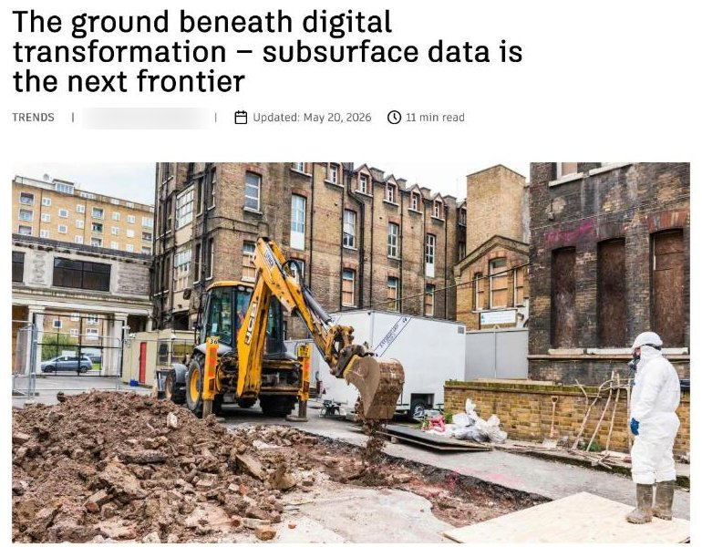

# Articles that platforms chose to publish

*Long-form pieces produced for independent industry platforms: a profile per platform, research in parallel from the company's own knowledge and from real assistant-prompt data, one writer, a verification stage, and a person who pitches and places the piece. The rebuild is two tools anyone can run.*

## Before

The owned domain had no top-of-funnel content: short posts, no internal links, nothing an engineer outside the German-speaking circle would find when searching, or when asking an assistant. Paid media could buy attention; nothing earned it.

## What we built

**A profile per platform.** Before any article, a skill researched the target platform and wrote its profile: editorial patterns, tone, structure, audience, what it rejects. Four platforms were profiled. The profile decided the mode of the piece: name the product, where the platform allows it, or build authority without a product link, where it does not.

**Research in parallel, three angles.** From the brief, three agents ran at once. A technical researcher read the company's own knowledge: the crawled docs, the demo transcripts, the competitor context. A prompt strategist read exports of real prompts people type into assistants, so the structure of the piece answered the questions engineers actually ask. An industry analyst stayed outside the company's files on purpose and collected third-party data and public project examples that a reader could verify.

*The design note from July 2026: the orchestrator as coordinator, three researchers firing together because they never read each other's sources, one writer fanning them in, and the four agents cut along trust boundaries of information. The technical researcher is the only agent allowed to touch proprietary knowledge; the industry analyst is forbidden from it.*

**One writer, in the platform's voice.** One agent wrote from the three research files and the platform profile, as a geotechnical professional would write for that platform, not as a vendor.

**Verification, then a person.** From July 2026 a verification stage checked every claim in the draft against its source before a person saw it. The person read it, pitched the platform, agreed the byline, and placed the piece. After publication, the prompts the piece was written to answer went into a tracking loop, so the next brief started from what the assistants were already citing.

## What stayed human

Which platform, which topic, which mode. The pitch and the relationship with the editor. The byline: the pieces went out under a colleague's name, produced and placed by the pipeline, never authored by it. And the publish itself; the pipeline ended in a folder.

## What it did

Eight finished pieces across three platforms. Three bylined articles on the leading independent geotechnical platform, and one on Autodesk's own blog, which also listed the product in its integrations round-up. By mid-2026 the assistants were doing the referring: ChatGPT, Gemini, Claude and Perplexity were sending visitors to the website, and some of them became qualified leads. Small in volume, measurable, and earlier than the market expected it.

Two of the pieces, as published:

| [Life after gINT: rethinking geotechnical data management for a new era](https://www.geoengineer.org/news/life-after-gint-rethinking-geotechnical-data-management-for-a-new-era), geoengineer.org, March 2026, sponsored | [The ground beneath digital transformation: subsurface data is the next frontier](https://www.autodesk.com/blogs/construction/the-ground-beneath-digital-transformation-subsurface-data-is-the-next-frontier/), Autodesk Digital Builder, May 2026 |
|---|---|
|  |  |

*Entity-building mode on the left, the product named and the piece marked sponsored; authority-building mode on the right, no product link, under a colleague's byline. Thumbnails are page crops that link to the originals.*

## What broke

The first pieces went to a writer with no check after it. A trial run in July caught claims the research had let through, confident sentences the sources did not support. The fix became a stage, not a reminder: from then on nothing reached a person without the verification pass, and the rebuild below makes that pass a script that cannot be talked into a PASS.

## Run it yourself

The pattern is rebuilt as two tools, generic, with no files from the original:

- [platform-profile](https://github.com/nunomnferreirapt/platform-profile) crawls what a company publishes into a git-tracked folder of clean, dated pages, and diffs them on every run. That folder is the vault's rebuild.
- [article-pipeline](https://github.com/nunomnferreirapt/article-pipeline) takes a brief and a list of allowed sources, runs three research agents and one writer in Claude Code, and refuses to hand over a draft until a plain-Python gate says PASS. Point its sources at the profile's folder and the two chain the way the original did.

What the rebuild leaves out, on purpose: the prompt-data strategist, which needs a paid export, and the platform profiler, which was specific to a handful of editorial sites. The mechanism is in [Parallel research, one writer](../../architecture/patterns/research-writer.md).
