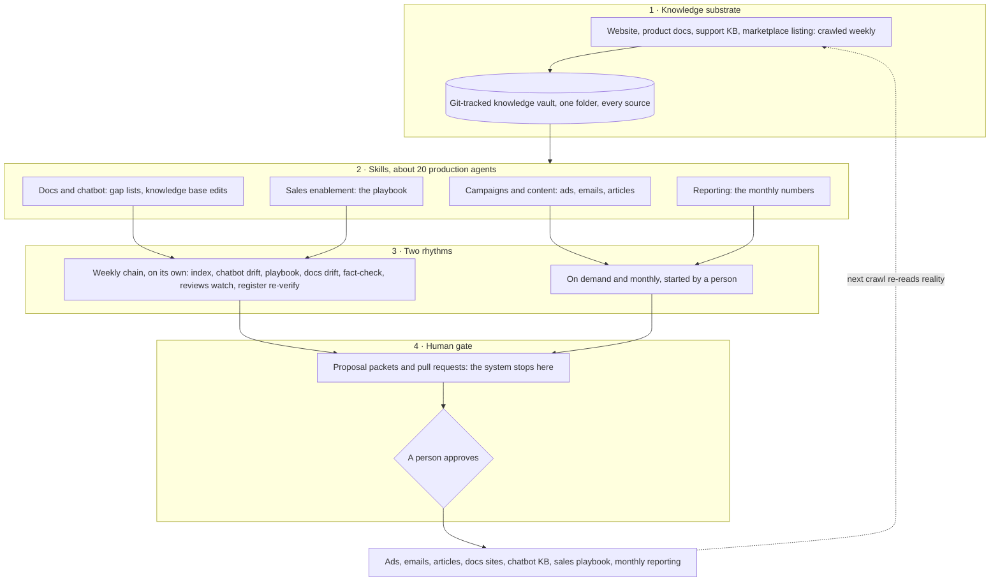

# How it was run: the AI operating system

*A team of one ran acquisition, content, docs, enablement and reporting through about 20 agent skills and weekly loops that draft everything and publish nothing. This is how.*

## The setup

GeoDin is Fugro's geotechnical data management software. It's been around for thirty years, mostly as a German desktop product sold on perpetual licenses. My job over the past three years was to turn it into a recurring-revenue business, and that meant building most of the business around the product from scratch:

- The offering and the pricing: dozens of legacy products consolidated into one product with three variants, priced per user (per device for the field app) and per country.
- Product decisions and role mapping, and a restructuring of the team so the product could actually be sold and used outside Germany.
- The growth engine itself: a CRM where there had been none, paid media, a new website, the trial flow, and self-checkout with VAT rules and prices per country.
- The migration: new pricing and discounts that moved the perpetual-license customers onto subscriptions.
- The financial reporting the whole business ran on, monthly, with corporate finance.
- Later, AI where it adds value for customers: the website chatbot, and a documentation portal for self-service learning, for new users and for power users alike.

The team for all of that was small. The scope wasn't: work that normally splits across a campaign manager, a content marketer, a technical writer, an enablement lead and a RevOps analyst, plus pricing and finance. Hiring it wasn't on the table.

So the work became: build an operating system of AI agents that does the repeatable parts continuously, and keep people where judgment is needed. This is how it's put together, and what deliberately stayed out of the machine's hands.

## How it's built

Of the list above, the pricing, the product decisions and the team were decided by people and stayed that way (more under "What stayed human"). Everything else had repeatable work in it, and that is what the operating system was built to run. Five parts:

**1. One source of truth.** Everything the product says about itself in public (website, documentation, support articles, marketplace listing) is crawled weekly into one folder under git. One rule: generated text is never a source. The agents cannot quote our own marketing copy back at us.

**2. Skills, not chats.** About twenty repeatable workflows, each written down as a file and run the same way every time. One writes articles: three research agents first, then one writer. One turns any source (a call transcript, a support thread, a spec) into gap lists per product and a pull request on the docs. One strips personal data from transcripts before a model reads them.

**3. Weekly loops.** The skills that have to run every week run in one chain, in dependency order: crawl first, then everything that depends on the crawl. If the crawl fails, the rest is marked as failed too rather than working from last week's sources. I looked at the results when I had time, saw what had run and what had failed, and acted on it.

**4. Proposals, then pull requests.** No loop publishes anything. A loop ends in a proposal; if the proposal is accepted, it becomes a pull request; a person merges it. Often that person was me. The point was never the approval step itself but the history: every change to the docs, the chatbot, the playbook or the campaigns is a PR anyone in the team can open and read.

**5. Coordination through the files themselves.** Every piece of work (a campaign, internal docs, the financial reporting) has a folder with a README that says what it is and where it stands. The PRs follow one structure, so colleagues could read them without knowing how they were produced. And the format followed the reader: the DevOps and client success teams got pull requests, the marketing coordinator got markdown files to use in their own AI tools. At the very end, the financial reporting was handed over the same way: a GitHub setup that let Fugro's corporate finance team run the reporting scripts themselves.

## What stayed human

- **Sending and merging.** Ads, emails, docs changes, chatbot updates: the agents drafted, a person sent or merged.
- **Pricing, packaging and partner terms.** The agents brought benchmarks and funnel numbers to the table. The decisions were ours.
- **Where the budget went.** A monthly look at the campaign numbers, and the calls that followed.
- **Anything a customer would read as our voice.** The chatbot's rules, in particular, were only ever changed by hand.

## Did it work?

The business made the shift: subscriptions carry it, the trial is the main way in for new customers, and the numbers are on the front page of this repo. This chapter is about the way of working, so the honest test is a different one: did a small team run a full go-to-market function through 2026 without the work piling up? It did. The docs, the chatbot and the sales playbook stayed current without anyone updating them by hand, campaigns and content kept going, and the time I had went into the decisions rather than the production.

## To know more

Each part of this page has its own chapter, written one at a time: the shift from perpetual licenses to subscriptions, the CRM, paid media, the chatbot, the documentation sites, the financial reporting, and the financial model behind the leadership presentations. The list, with what is already written, is in the [case studies index](README.md).
